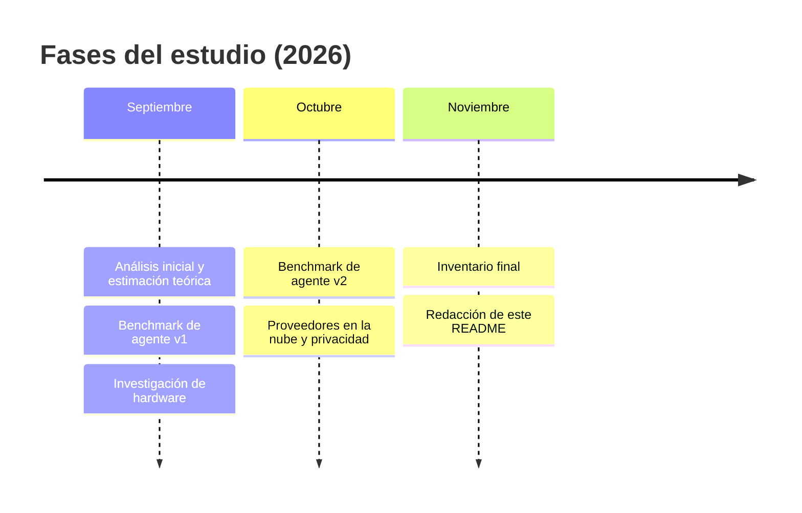
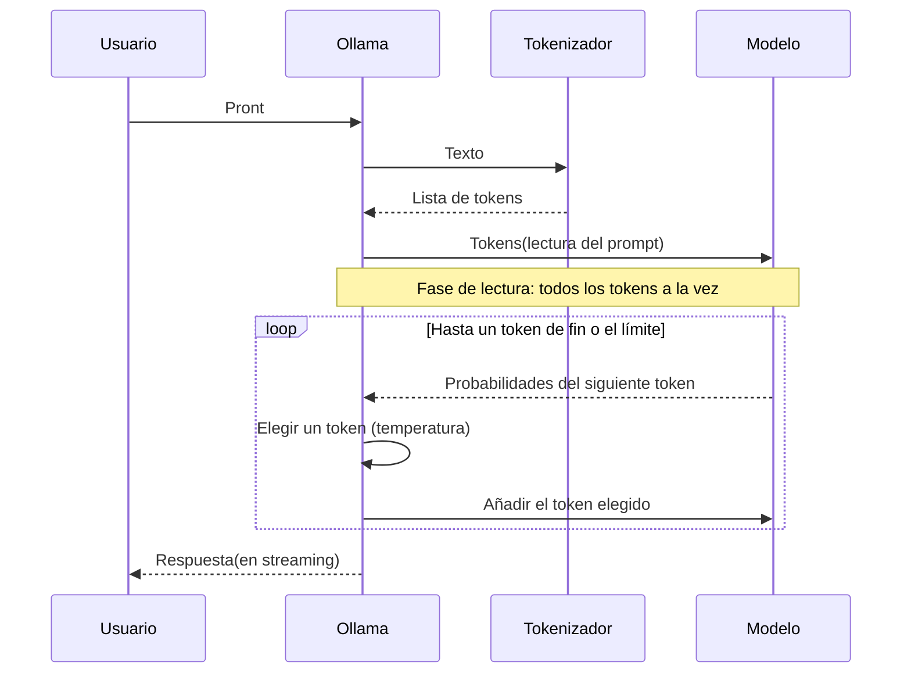
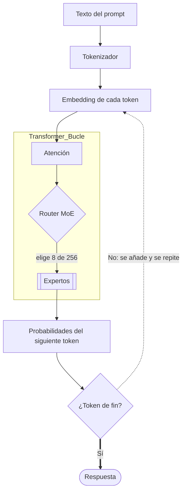
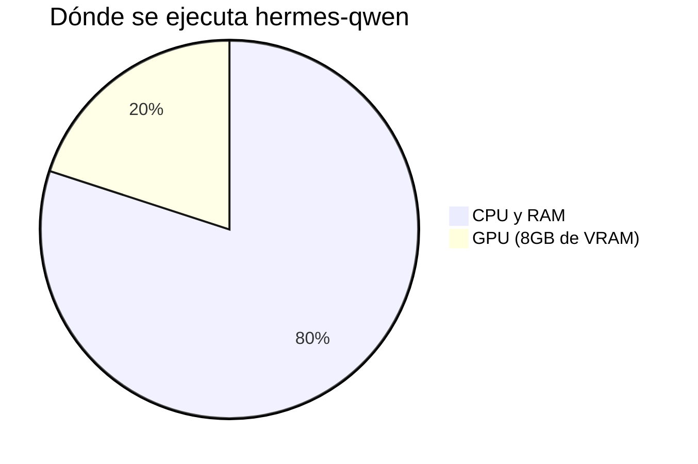
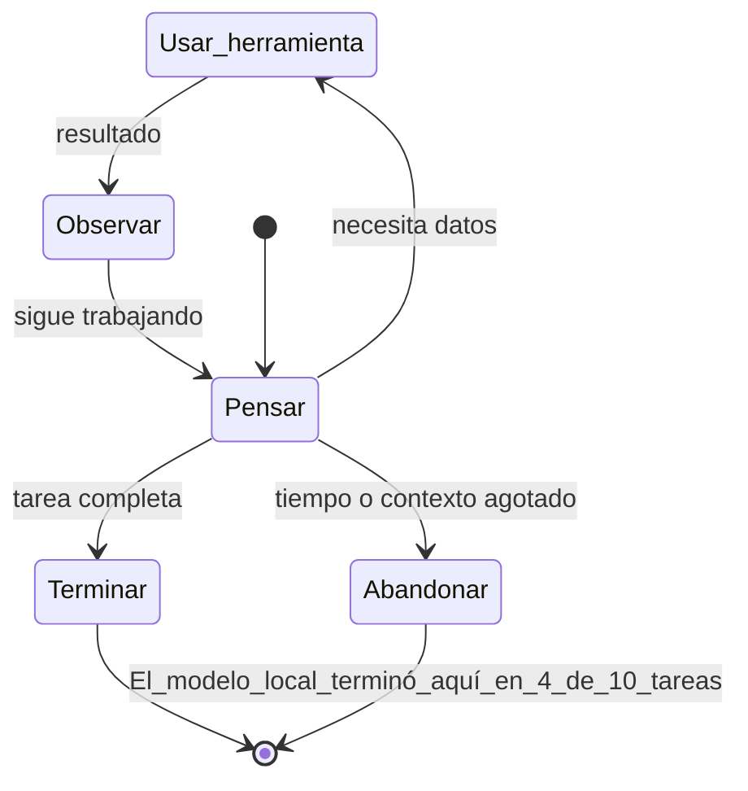
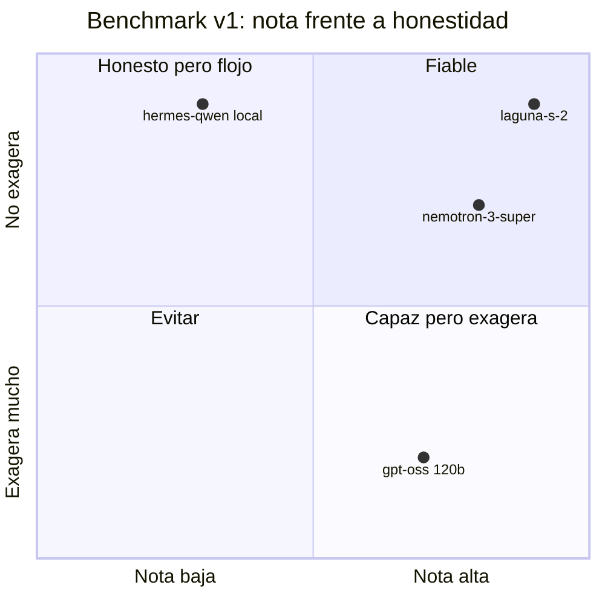
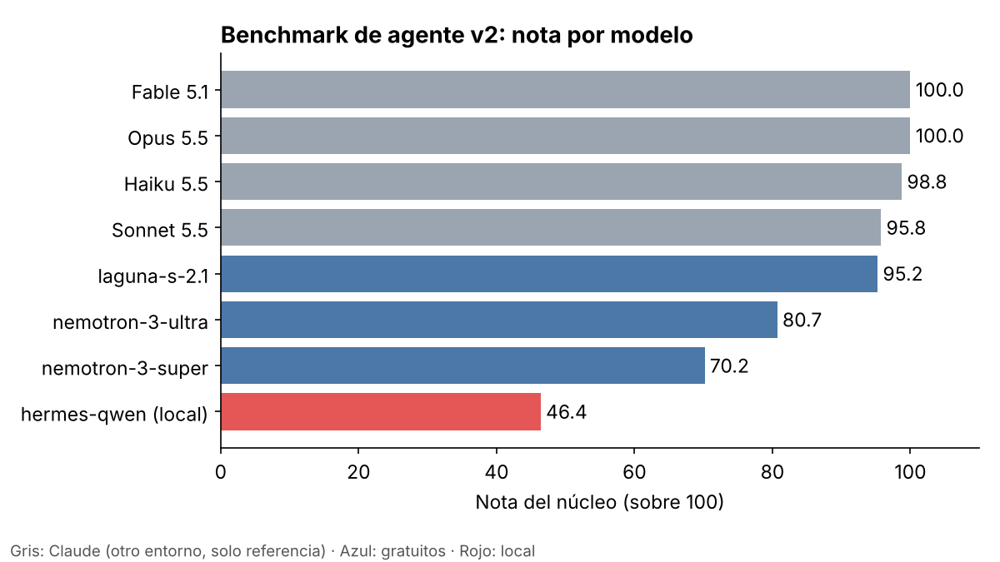
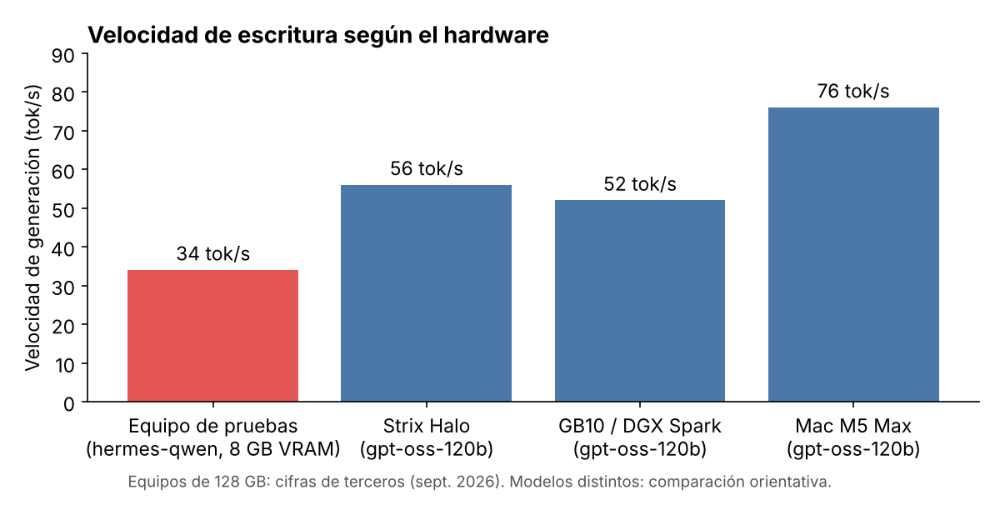
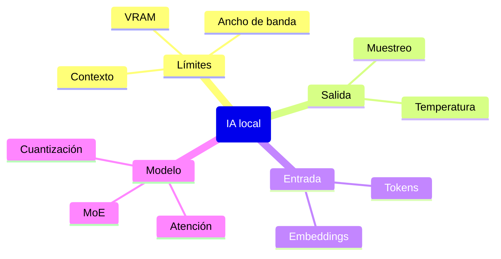

# 🧠 Estudio de uso de una IA local

**¿Qué pasa de verdad cuando un modelo de 35.000 millones de parámetros corre en un PC normal?**


<!-- Estudio de IA local -->
Datos reales de un equipo de pruebas · septiembre - noviembre de 2026

>All models are wrong, but some are useful.
>
> **-George E.P. Box**, estadístico

---
<a id="Indice"></a>
# 📋 **Índice**

1. [🧪El experimento](#El-experimento)
2. [📦El inventario](#El-inventario)
3. [⚙️Cómo funciona por dentro](#Como-funciona-por-dentro)
4. [🚀Rendimiento en el equipo de pruebas](#Rendimiento-en-el-equipo-de-pruebas)
5. [♟️Benchmarks de agente](#Benchmarks-de-agente)
6. [🖥️¿Y con otro hardware?](#Y-con-otro-hardware)
7. [🔒Local vs nube: la privacidad](#Local-vs-nube:-la-privacidad)
8. [🗒️Conclusiones](#Conclusiones)
9. [⛲Fuentes](#Fuentes)
---

<a id="El-experimento"></a>
# 🧪 El experimento

Este documento es un **estudio de uso** de una IA que funciona *en local*, sin enviar nada a Internet. No es una reseña ni un tutorial: son mediciones reales, agrupadas y explicadas con la teoría que hay detrás de cada número.

La pregunta de partida era sencilla: ¿se puede usar en casa un modelo grande como \<\<cerebro>> de un agente autónomo?
La respuesta corta es "Sí, pero...".
La respuesta larga es el resto de este documento.

> El estudio no lanza pruebas nuevas: reutiliza mediciones que ya se habían hecho para ahorrar tiempo de GPU y energía. Las pruebas que no se habían hecho antes se han dejado fuera del estudio, como se resume en las [conclusiones](#Conclusiones).

## 🖥️ El equipo de pruebas

**CPU:** 8 núcleos / 16 hilos \
**RAM:** 32GB \
**GPU:** dedicada, con 8 GB de VRAM \
**Sistema:** Windows 11 (64 bits)

El dato que lo condiciona todo es el último de la lista de hardware: **8 GB de VRAM**. Ya veremos por qué.

## 🗓️ Fases del estudio


[⬆️ Volver al índice](#Indice)

---

<a id="El-inventario"></a>
# 📦 El inventario

El servidor de modelos es [Ollama](#https://ollama.com "Web oficial de Ollama"), versión `0.40.4`. Estos son los modelos instalados:

| Modelo | Familia | Parámetros | Cuantización | Tamaño | Tipo |
| :-- | :-: | --: | :-: | --: | :-- |
|`qwen3.6:35b-a3b`|qwen35moe|35,5B (~3B activos)|Q4_K_M|22,62 GB| Chat, visión, herramientas |
|`hermes-qwen`|qwen35moe|35,5B (~3B activos)|Q4_K_M|22,62 GB|Chat para agente (contexto 65.536)|
|`qwen2.5:7b`|qwen2|7,6B|Q4_K_M|4,68 GB|Chat con herramientas|
|`andy-4:micro-q8_0`|qwen2|1,8B|Q8_0|1,89 GB| Agente de videojuego|
|`nomic-mebed-text`|nomic-bert|137M|F16|0,27GB|Embeddings (768 dimensiones)|

Los datos completos están en `datos/inventario.csv`.

## 🔢 ¿Por qué 35.500 millones de parámetros saben en 22,6GB?

Por la **cuantización**: en vez de guardar cada peso con 16 bits, se guarda con unos 4-5. El tamaño aproximado de un modelo $M \approx N \cdot \frac{b}{8}$ bytes, donde $N$ es el número de parámetros y $b$ los bits por peso.

$$
M \approx 35,5 \cdot 10^9 \cdot \frac{5,1}{8} \approx 22,6 GB
$$

`Q4_K_M` usa de media algo más de 4 bits porque guarda con más precisión las partes más delicadas del modelo.

## Comandos para sacar este inventario

```powershell
    ollama --version # versión instalada
    ollama list # modelos y tamaño en disco
    ollama show qwen2.5:7b # parámetros, cuantización y contexto de un modelo
    ollama ps # modelos cargados ahora mismo y reparto CPU/GPU
```

[🗒️ Ver el CSV del inventario](datos/inventario.csv) \
[⬆️ Volver al índice](#Indice)

---

<a id="Como-funciona-por-dentro"></a>
# ⚙️ Cómo funciona por dentro

Antes de mirar los números conviene saber qué hace el modelo con cada pregunta. Este es el viaje completo de un *prompt*:



## 🧩 1.Tokens

El modelo no lee letras ni palabras: lee **tokens**, trozos de texto de tamaño variables. Una palabra común puede ser un solo token y una rara, tres o cuatro. Por eso los límites y las velocidades se miden en tokens, no en palabras.

## 🔴 2.Embeddings

Cada token se convierte en un **vector**: una lista de números que representa su significado. En `nomic-embed.text` cada texto se convierte en un vector de 768 dimensiones. Dos textos parecidos dan vectores que apuntan en direcciones parecidas, y eso se mide con la similitud coseno:

$$
cos\theta = \frac{\vec{a}\cdot\vec{b}}{\left\| \vec{a} \right\|\left\| \vec{b} \right\|}
$$

Vale **1** si apunta igual, **0** si no tiene relación y **-1** si son opuestos.

## 👀 3.Atención

Es la pieza clave del **Transformer**. cada token \<\<mira>> a todos los anteriores para decidir cuáles importan para entenderlo:

$$
Attention(Q,K,V) = sfotmax(\frac{QK^T}{\sqrt{d_k}})V
$$

- $Q$(query): lo que busca el token actual.
- $K$(key): lo que ofrece cada token anterior.
- $V$(value): la información que se lleva si es relevante.

> We propose a new simple network architecture, the Transformer, based solely on attention mechanis,s.
>
> **-Vaswani et al.**, [Attention Is All You Need](https://arxiv.org/abs/1706.03762) (2017)


Arquitectura de un modelo GPT. Imagen de Wikimedia Commons (CC0).

## 🎲 4.Generar texto y temperatura

El modelo no \<\<escribe>>: calcula una puntuación $z_i$ para cada token posible y la convierte en probabilidad. La **temperatura** $T$ decide cuánto se arriesga:

$$
p_i = \frac{e^{\frac{z_i}{T}}}{\sum_j e^{\frac{z_j}{T}}}
$$

1. Con $T$ --> 0 casi siempre gana el token más probable: respuestas repetibles.
2. Con $T$ = 1 se respeta la distribución tal cual.
3. Con $T$ > 1 las opciones raras ganan peso: más creatividad y más disparates.
   
## 🧑‍🔬 5.Mezcla de expertos (MoE)

`qwen3.6:35b-a3b` no usa sus 35.500 millones de parámetros en cada token. Tiene **256 expertos** y un router que elige solo **8** por token:

$$
Y = \sum_{i\in Top-8}g_i(x)E_i(x)
$$
donde $E_i$ es la salida del experto $i$ y $g_i$ el peso que le da el router. \
Resultado: unos **3B de parámetros activos** por token, aunque en memoria tenga que estar el modelo entero.



## 🧠 6.Contexto y caché KV

Para no recalcular la atención de todo el texto en cada token, el modelo guarda las $K$ y $V$ de los tokens anteriores: la **caché KV**. Crece con el tamaño del contexto:

$$
KV = 2 \cdot n_{capas} \cdot n_{kv} \cdot d_{cabeza} \cdot n_{ctx} \cdot bytes
$$
Por eso ampliar `hermes-qwen` a un contexto de **65.536** tokens dispara la memoria necesaria, aunque el modelo sea el mismo.

## ⚖️ 7.Lectura vs escritura

| Fase | Qué hace | Qué limita |
| :-- | :-: | --: |
| **Lectura**(prefill) | Procesa todo el prompt a la vez | Potencia de cálculo |
| **Escritura**(decode) | Genera un token cada vez | Ancho de banda de memoria |
En la  escritura, por **cada token** hay que leer de memoria todos los pesos activos. La velocidad depende de cuántos bytes hay que mover, no de lo rápido que calcula el procesador.

[⬆️ Volver al índice](#Indice)

---

<a id="Rendimiento-en-el-equipo-de-pruebas"></a>
# 🚀 Rendimiento en el equipo de pruebas

Solo hay mediciones del modelo de uso diario, `hermes-qwen`:

| Métrica | Valor |
| :-- | --: |
| Velocidad de escritura | ~34 tok/s |
| Velocidad de lectura del prompt | ~64 tok/s |
| Escritura en llamadas reales del agente | 21-37 tok/s |
| Primera respuesta con un prompt de 7.200 tokens | 32-39 s |
| reparto CPU / GPU (contexto 65.536) | 80% / 20% |
La estimación inicial era de ~15-25 tok/s~. El valor medido es **34 tok/s**: bastante mejor de lo esperado.



## 🧮 La paradoja: 80% en CPU y aun así rápido

Un modelo de 22,6 GB no cabe en 8 GB de VRAM, así que la mayor parte corre en la CPU. Lo esprable sería que fuese lentísimo. Pero gracias al MoE solo se leen los ~ **3B de parámetros activos** por token. Con la fórmula de la escritura, se puede despejar el ancho de banda que hace falta:

$$
\begin{aligned}
v &\approx  \frac{BW}{N_{activos} \cdot \frac{b}{8}} \\
BW &\approx v \cdot N_{activos} \cdot \frac{b}{8} \\
&\approx 34 \cdot 3 \cdot 10^9 \cdot \frac{4,85}{8}bytes/s \approx 62 GB/s
\end{aligned}
$$
Unos **62 GB/s** es justo lo que da una RAM moderna de soble canal. Es decir: el límite real no es la CPU, es la memoria. Un modelo *denso* del mismo tamaño tendría que leer los 22,6 GB enteros por token y no pasaría de $ \frac{62}{22,6} \approx 3$ tok/s.

> Importante: Hay una cifra que no cuadra. Leer 7.200 tokens a 64 tok/s llevaría $ t = \frac{n}{v} = \frac{7200}{64} \approx 112$s, pero la primera respuesta tardó solo 32-39s, es decir, unos 200 tok/s de lectura. Lo más probable es que las dos mediciones se hicieran en condiciones distintas. Queda como discrepancia abierta.

## 🔧 Cómo medirlo tú

> [!TIP] Ejecuta `ollama run qwen2.5:7b --verbose`, haz una pregunta y al final verás `pront eval rate` (lectura) y `eval rate` (escritura). Para salir, escribe `/bye` o pulsa "Ctrl" + "D".

La API decvuelve los tiempos en nanosegundos. Esta es la formula de una respuesta (valores de ejemplo):

```JSON
    {
        "model": "hermes-qwen",
        "prompt_eval_count": 1200,
        "promt_eval_duration": 187500000000,
        "eval_count": 300,
        "eval_duration": 8820000000,
        "done": true
    }
```

Y este script calcula las dos variables a partir de ella:

```PYTHON
import json

with open("respuesta.json",encoding="utf-8") as archivo: respuesta = json.load(archivo)

NANOSEGUNDOS_POR_SEGUNDO = 1_000_000_000

velocidad_lectura = respuesta["prompt_eval_count"] / (respuesta["prompt_eval_duration"] / NANOSEGUNDOS_POR_SEGUNDO)
velocidad_escritura = respuesta["eval_count"] / (respuesta["eval_count"] / NANOSEGUNDOS_POR_SEGUNDO)

print(f"Lectura: {velocidad_lectura: .1f} tok/s")
print(f"Escritura: {velocidad_escritura: .1f} tok/")
```

[⬆️ Volver al índice](#Indice)

---

<a id="Benchmarks-de-agente"></a>
# ♟️Benchmarks de agente

Un agente no solo responde:**piensa, usa herramientas, mira el resultado y vuelve a pensar**. Se probó el modelo local como cerebro de un agente frente a modelos de la nube.



## 🥉 Benchmark v1: 10 tareas, 100 puntos

**Método:**

1. El agente resuelve 10 tareas en un entorno aislado, con datos sintéticos:
   - lectura y cinteo, CSV sucio, organizar archivos y estracción;
   - recuperación de errores, código y contexto largo (~35K tokens);
   - resistencia a inyección de instrucciones, redacción e informe honesto.
3. La corrección es automática y determinista.
4. Se penaliza la **sobreafirmación**: decir que algo está hecho sin estarlo.

| Modelo | Dónde | Ronda 1 | Ronda 2 | Media | Sobreafirmaciones |
| :-- | --- | --: | --: | --: | --- |
| laguna-s-2.1 | Pasarela gratuita | 100 | 100 | 100 | 0 |
| nemotron-3-super | Nube de Ollama | 100 | 91 | 95,5 | 1 |
| gtp-oss:120b | Nube de Ollama | 73,3 | 86,3 | 79,8 | 3 |
| **hermes-qwen** | **Local** | 8 | 49,7 | 28,9 | 0 |

>[!WARNING]
  Una ronda "vacía" puntúa 8 por falsos positivos del corrector. La nota real de la segunda ronda del modelo local se estima en $\approx$42,7.


### Lento pero honesto

El modelo local es peor en nota, pero **no miente nunca** sobre lo que ha hecho. El gráfico cruza las dos cosas: nota media (horizontal) y honestidad (vertical).


Otro detalle engañoso: el modelo local gastó $\approx$**0,46M tokens**, frente a 0,9-2M de nemotron y 7,6-9,7M de gpt-oss. No es eficiencia: es que **abandonaba antes**.

## 🥇 Benchmark v2: tareas más difíciles

Ahora las tareas incluían una app web, ampliar un programa de ~3.000 líneas, una impresora 3D simulada, facturas o investigar con fuentes contradictorias.



>[!CAUTION] Los modelos Claude se ejecutaron en **otro entorno**(Claude Code), no dentro del mismo agente. Sirven como techo de referencia, no como comparación directa.
Los datos están en `datos/benchmark_v1.csv` y `datos/benchmark_v2.csv`.

## ⚖️ ¿Cuánto me puedo fiar de una nota?
El modelo local sacó **42,45** y **49,42** en sus dos rondas del v2. Su medida es $\bar{x} = \frac{43,45 + 49,42}{2} \approx 46,4$ y sy desviación típica:

$$
s = \sqrt{\frac{\sum^{n}_{i=1}(x_i - \bar{x})^2}{n - 1}} = \sqrt{\frac{2,985^2 + 2,985}{1}} \approx 4,2
$$
Con solo **2 rondas** y una variación de 6 puntos, diferencias pequeñas entre modelos no significan nada.

[⬆️ Volver al índice](#Indice)
---

<a id="Y-con-otro-hardware"></a>
# 🖥️ ¿Y con otro harware?
Si la velocidad de escritura depende del **ancho de banda de memoria**, la forma de ir más rápido es tener más memoria rápida, no más núcleos. Cifras de terceros para equipos de 128 GB de memoria unificada:
| Equipo | Lectura (tok/s) | Escritura (tok/s) | Espera con un pront de 12K |
| :-- | --- | --- | --- |
| Strix Halo | 605-679 | 56 | ~19s |
| GB10 (DGX Spark y similares) | 1.307-1.512 | 52 | ~7-8 s |
| Mac Studio M5 Max | 2.710 | 76 | ~5 s|
Modelo: gpt-oss-120b. Otra investigación de noviembre da cifras algo distintas (49-88 tok/s); los precios no se incluyen porque cambian a diario.


Fíjate en que estos equipos mueven un modelo de **120B**(unos 5B activos) más rápidp de lo que el equipo de pruebas mueve uno de 35B: tienen la memoria en el mismo chip y con mucho más ancho de banda.

<div class="alert alert-success">
  Con modelos gigantes, como uno de 510 GB de pesos, en un equipo doméstico manda la RAM: las cifras disponibles van de 1,8 a 4,7 tok/s. En el equipo de pruebas no es usable.
</div>

[⬆️ Volver al índice](#Indice)

---

<a id="Local-vs-nube:-la-privacidad"></a>
# 🔒 Local vs nube: la privacidad
El motivo principal para tener una IA en casa no es la velocidad, es el **control**:
- 🏠**local**: nada sale del equipo.
    - Coste: electricidad y hardware.
    - Límite: la memoria.
- ☁️**Nube gratuita**: algunos proveedores retienen los datos y entrenan con ellos por defecto.
- 🔐**Nube privada**: existen opciones con cómputo confiencial (TEE) o retención cero por contrato (ZDR).
    - Coste estimado: de 2,34 a 7,95 por 10 sesiones de agente.
    - Una GPU de 96 GB alquilada cuesta ~3,19 euros/h: se paga privacidad, no ahorro.
>Get up and running with large language models.
>
>-Descripción del proyecto [Ollama en GitHub](#https://github.com/ollama/ollama)


[⬆️ Volver al índice](#Indice)
---

<a id="Conclusiones"></a>
# 📋 Conclusiones



## 👍 Lo que se ha aprendido
1. **El cuello de botella es la memoria**, no la CPU.
    - Al escribir, cada token obliga a leer todos los pesos activos.
    - Por eso un MoE con 3B activos va a 34 tok/s aunque esté al 80% en CPU.
3. **El modelo local sirve para tareas cortas y acotadas.**
    - Su mejor resultado: la tarea de la impresora 3D, 14/14 en las dos rondas.
    - En tareas largas abandona antes de terminar.
4. **Honestidad y capacidad son cosas distintas**: el modelo con peor nota fue el que menos exageró.
5. **Con 1-2 rondas no se puede concluir casi nada** sobre diferencias pequeñas.

## 📋 Checklist del estudio
- [x] Inventario de modelos
- [x] Rendimiento del modelo principal
- [x] Benchmarks de agente v1 y v2
- [x] Investigación de hardware
- [x] Comparativa de privacidad local vs nube
- [x] Explicación del funcionamiento interno
- [x] Redacción de este README
El estudio se limita a los datos que ya existían: no se han lanzado pruebas nuevas.
>We can only see a short distance ahead, but we can see plenty there that needs to be donde.
>
>--- **Alan Turing**, Computing Machinery and Intelligence (1950)

Por eso algunas partes, como la temperatura o los embeddings, se explican solo con teoría y sin mediciones propias.

[⬆️ Volver al índice](#Indice)
---

<a id="Fuentes"></a>
# ⛲ Fuentes
- [Ollama](https://ollama.com/) y su [documentación de la API](https://github.com/ollama/ollama/blob/main/docs/api.md)
- [Attention Is All You Need](https://arxiv.org/abs/1706.03762), el artículo del Transformer
- Rendimi9ento de terceros: [llama.cpp #16578](https://github.com/ggml-org/llama.cpp/discussions/16578), [llama.cpp #15396](https://github.com/ggml-org/llama.cpp/discussions/15396), [vLLM en DGX Spark](https://vllm.ai/blog/2026-06-01-vllm-dgx-spark), [benchmarks de M5 Max](https://www.hardware-corner.net/m5-max-local-llm-benchmarks-20261233/), [doble RTX 3090](https://computingforgeeks.com/build-dual-rtx-3090-llm/)
- Datos propios: [inventario](datos/inventario.csv), [rendimiento local](datos/rendimiento_local.csv), [benchmark v1](datos/benchmark_v1.csv), [benchmark v2](datos/benchmark_v2.csv)


[⬆️ Volver al índice](#Indice)
---

Hecho con 🧠 local, ☕ y mucho `Markdown` --> sin *trucos* &copy; 2026
